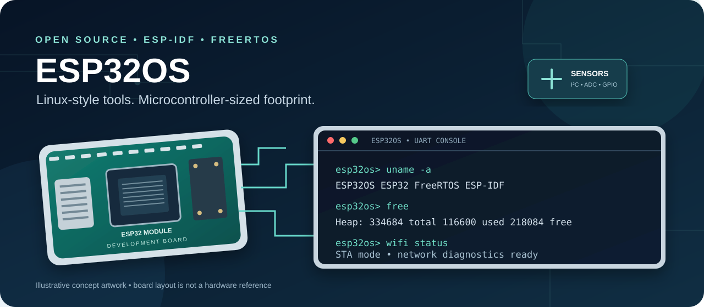
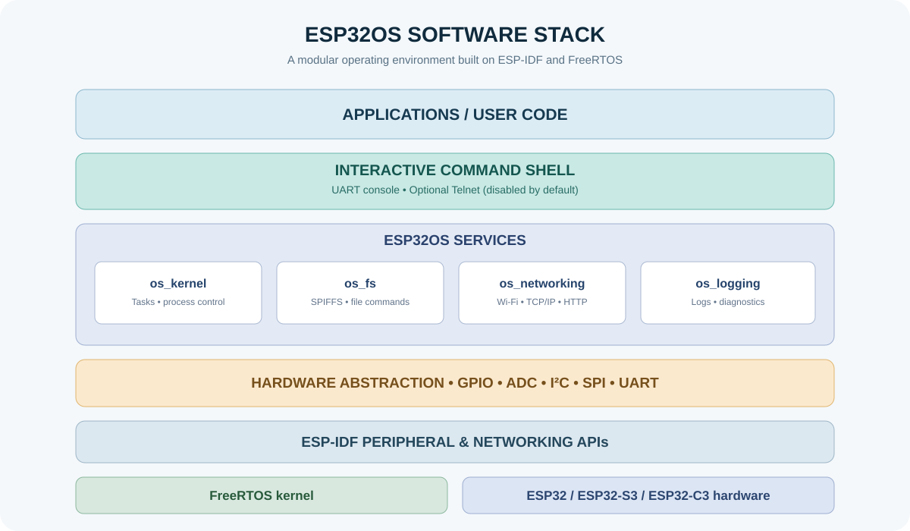
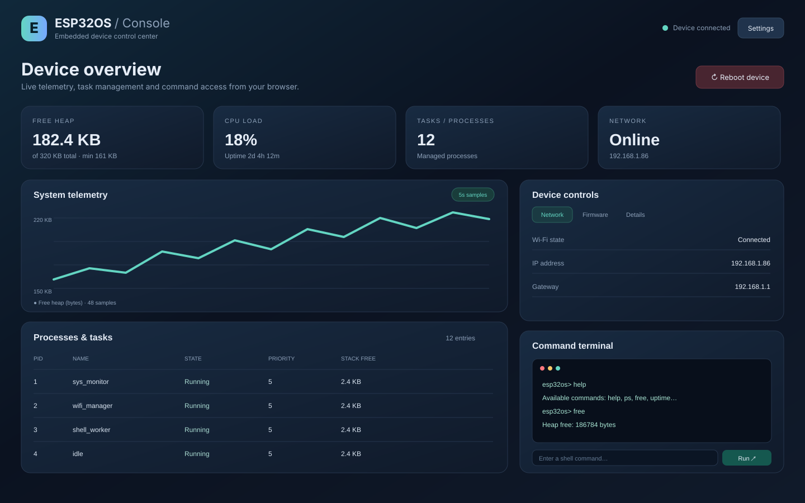
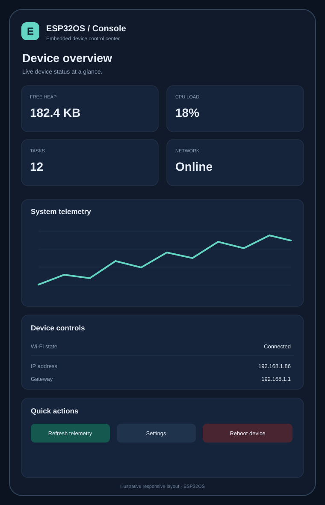

<div align="center">

# ESP32OS

### A Linux-style command environment for ESP32 microcontrollers.

**Build, inspect and control embedded systems with a modular C17 runtime, FreeRTOS task management and an interactive shell.**

[](https://github.com/espressif/esp-idf)
[](https://docs.espressif.com/projects/esp-idf/en/stable/esp32/)
[](https://en.cppreference.com/w/c/17)
[](https://www.freertos.org/)
[](LICENSE)
[](https://github.com/faizannazir/Esp32OS/stargazers)
[](https://github.com/faizannazir/Esp32OS/network/members)
[](https://github.com/faizannazir/Esp32OS/actions)

[Explore features](#-features) · [Get started](#-quick-start) · [Commands](#-shell-at-a-glance) · [Contribute](#-contributing)

</div>

<p align="center">
  
</p>

> **What is ESP32OS?** ESP32OS is an open-source embedded operating environment built on ESP-IDF and FreeRTOS. It brings a familiar Linux-style shell, task and process controls, filesystem commands, networking tools, hardware access and modular services to ESP32-class microcontrollers. It is not a Linux distribution and does not replace the underlying FreeRTOS kernel.

---

## ✨ Features

<table>
<tr>
<td width="50%">
<h3>⌨️ Interactive shell</h3>
UART command line, command history, ANSI output, extensible commands and a customizable browser dashboard.
</td>
<td width="50%">
<h3>🧠 Task & process tools</h3>
Inspect, suspend, resume and terminate managed tasks. Check uptime, heap and runtime state.
</td>
</tr>
<tr>
<td>
<h3>📁 Embedded filesystem</h3>
SPIFFS-backed file commands for browsing, reading, writing, moving and removing files.
</td>
<td>
<h3>📡 Wi-Fi & networking</h3>
Scan and connect to Wi-Fi, inspect connection status, ping hosts and make HTTP requests.
</td>
</tr>
<tr>
<td>
<h3>🔌 Hardware access</h3>
Shell commands for GPIO, ADC and I²C, with a modular driver layer for peripheral expansion.
</td>
<td>
<h3>⚙️ Modular services</h3>
PWM, timers, IPC, MQTT, OTA, environment variables and scheduled/background commands.
</td>
</tr>
<tr>
<td>
<h3>📋 Logging & diagnostics</h3>
Multi-level logs, in-memory ring buffer, filesystem logging and watchdog integration.
</td>
<td>
<h3>🛡️ Safer defaults</h3>
UART-first access. Optional AP fallback, Telnet and the unauthenticated web portal are disabled by default.
</td>
</tr>
</table>

## 🧩 How it fits together

<p align="center">
  
</p>

ESP32OS is a service layer above ESP-IDF and FreeRTOS. The shell provides a consistent operator interface while components keep kernel, filesystem, networking, logging and hardware responsibilities separate.

## 🎯 Supported targets

| ESP-IDF target | Chip family | CI build |
|---|---|---|
| `esp32` | Original ESP32 | [](https://github.com/faizannazir/Esp32OS/actions) |
| `esp32s3` | ESP32-S3 | [](https://github.com/faizannazir/Esp32OS/actions) |
| `esp32c3` | ESP32-C3 | [](https://github.com/faizannazir/Esp32OS/actions) |

Build coverage does not mean every board variant or peripheral has been physically tested. Check the issues and release notes for board-specific status.

## 🚀 Quick start

### Requirements

- ESP-IDF **6.0** toolchain (the project CI uses the Espressif ESP-IDF 6.0 container)
- Python 3.8 or newer for host-side test tools
- A supported ESP32 development board and USB data cable
- USB serial drivers and a serial terminal

### 1. Clone the repository

```bash
git clone https://github.com/faizannazir/Esp32OS.git
cd Esp32OS
```

### 2. Activate ESP-IDF

```bash
. "$IDF_PATH/export.sh"
```

If ESP-IDF is not installed yet, follow the [official ESP-IDF installation guide](https://docs.espressif.com/projects/esp-idf/en/v6.0/esp32/get-started/).

### 3. Select a chip and build

Choose the target that matches your physical board:

```bash
idf.py set-target esp32       # Original ESP32
# idf.py set-target esp32s3   # ESP32-S3
# idf.py set-target esp32c3   # ESP32-C3

idf.py build
```

### 4. Flash and open the serial console

Replace the port with the one assigned to your board:

```bash
idf.py -p /dev/ttyUSB0 flash monitor
```

On macOS, the port may look like `/dev/cu.usbserial-XXXX`. The default console baud rate is **115200**.

When the firmware starts, use the shell prompt:

```text
ESP32OS Embedded OS
Type 'help' for commands

esp32os> help
esp32os> uname -a
esp32os> free
esp32os> ps
```

## 🖥️ Interactive browser dashboard

ESP32OS also includes an optional browser dashboard served directly from the device. Monitor heap, CPU load, uptime, processes and Wi-Fi status; inspect telemetry; manage tasks; and use the shell from a browser.

<p align="center"><strong>Desktop dashboard preview</strong></p>

<p align="center"></p>

<p align="center"><strong>Responsive mobile layout preview</strong></p>

<p align="center"></p>

Personalize the dashboard from **Settings**: choose dark, light or system appearance; select an accent color; switch between comfortable and compact density; set automatic refresh from 3 to 30 seconds or manual refresh; change the page heading; and show or hide individual panels. Preferences are stored locally in the browser and do not alter firmware or network configuration.

See the [Browser Dashboard guide](docs/DASHBOARD.md) for setup, customization and security details.

## 🖥️ See the shell in action

The following is an illustrative terminal session. Actual memory values, chip names and available commands depend on the board and firmware configuration.

```text
esp32os> uname -a
ESP32OS  ESP32-S3  WiFi  ESP-IDF

esp32os> free
Heap:       total        used        free
            334684      116600      218084

esp32os> wifi status
Wi-Fi station status and network details

esp32os> ps
PID     NAME             STATE
1       sys_monitor      Running
2       idle             Ready
```

## 🧰 Shell at a glance

| Area | Example commands | What they do |
|---|---|---|
| System | `help`, `uname -a`, `uptime`, `free`, `reboot` | System information and control |
| Processes | `ps`, `top`, `kill`, `suspend`, `resume` | Inspect and manage tasks |
| Files | `ls`, `cd`, `pwd`, `cat`, `write`, `rm`, `mkdir`, `df` | Work with the SPIFFS filesystem |
| Wi-Fi | `wifi scan`, `wifi connect`, `wifi status` | Discover and manage networks |
| Network | `ping`, `http`, `ifconfig` | Basic network diagnostics |
| Hardware | `gpio`, `adc`, `i2c` | Inspect and control supported peripherals |
| Logs | `dmesg`, `loglevel`, `logfile` | Review system logs |
| Environment | `env`, `export`, `unset`, `printenv` | Manage runtime variables |
| Scheduling | `run`, `at`, `every`, `jobs`, `killjob` | Run commands asynchronously |
| Feature modules | `pwm`, `timer`, `msgq`, `event`, `mqtt`, `ota` | Use optional service modules |

For complete syntax and examples, see the [User Guide](docs/USER_GUIDE.md) and [Components Reference](docs/COMPONENTS.md).

## 🔐 Security defaults

ESP32OS is configured to prefer local UART access:

- **Wi-Fi AP fallback:** disabled by default. If explicitly enabled, the current fallback AP is open.
- **Telnet shell:** disabled by default. If enabled, Telnet sends credentials and commands in plaintext.
- **Web control portal:** disabled by default. The portal currently has no authentication and exposes device-control functionality.

Only enable these options on an isolated development network after understanding the risks. Configure them locally through:

```bash
idf.py menuconfig
```

Look for **ESP32OS Security and Network Services**. Do not commit local `sdkconfig` files or credentials. Do not expose unauthenticated management interfaces to the internet or an untrusted LAN.

## 🧪 Tests and continuous integration

The GitHub Actions pull-request workflow builds firmware for ESP32, ESP32-S3 and ESP32-C3, runs host-side test-harness checks and validates build health. The master workflow builds the same targets and publishes firmware artifacts when its release job completes.

Run the host-side checks locally:

```bash
python3 -m py_compile tools/test_integration.py
python3 -m py_compile tools/test_shell_host_integration.py
python3 -m py_compile tools/test_build_health.py
python3 tools/test_shell_host_integration.py
```

After building a target, validate its build artifacts:

```bash
python3 tools/test_build_health.py --target esp32
```

Hardware integration tests require a connected board:

```bash
python3 -m pip install pyserial
python3 tools/test_integration.py --port /dev/ttyUSB0
```

See [Testing](docs/TESTING.md) for the full test strategy. Browse [Actions](https://github.com/faizannazir/Esp32OS/actions) and [Releases](https://github.com/faizannazir/Esp32OS/releases) for current run results and downloadable firmware.

## 🗂️ Project layout

```text
Esp32OS/
├── main/                  # Application entry point and startup sequence
├── components/
│   ├── os_kernel/         # Task and process management
│   ├── os_fs/             # Filesystem abstraction
│   ├── os_networking/     # Wi-Fi and network services
│   ├── os_logging/        # Logging and diagnostics
│   ├── os_drivers/        # GPIO, ADC, I2C and peripheral drivers
│   ├── os_hal/            # Hardware abstraction layer
│   ├── os_shell/          # Shell engine and built-in commands
│   └── webportal/         # Optional web control portal
├── docs/                  # Guides, architecture and project assets
├── examples/              # Example applications
├── tools/                 # Host-side test and validation scripts
├── Kconfig.projbuild      # ESP32OS feature configuration
├── partitions.csv         # Flash partition table
└── sdkconfig.defaults     # ESP-IDF project defaults
```

## 🤝 Contributing

ESP32OS is built to be explored, improved and extended by embedded developers. Contributions are welcome, including bug fixes, drivers, shell commands, tests, documentation and board validation.

**A good first contribution:**

1. Browse [open issues](https://github.com/faizannazir/Esp32OS/issues).
2. Look for tasks labelled `good first issue` or propose a focused improvement.
3. Fork the repository and create a feature branch.
4. Build and run the relevant tests.
5. Open a pull request with the problem, solution, test results and any hardware used.

Before contributing, read [CONTRIBUTING.md](docs/CONTRIBUTING.md), [Architecture](docs/ARCHITECTURE.md) and [Testing](docs/TESTING.md).

### Contribution ideas

- Add and validate drivers for sensors and common peripherals.
- Improve shell usability, command help and diagnostics.
- Add examples for ESP32, ESP32-S3 and ESP32-C3 boards.
- Expand automated tests and hardware-in-the-loop coverage.
- Improve documentation, diagrams and beginner setup instructions.
- Review security boundaries for optional network services.

If ESP32OS is useful, consider **starring the repository** to help other embedded developers discover it. Share reproducible bugs and tested board configurations so the project can improve.

## 📚 Documentation

| Resource | Description |
|---|---|
| [User Guide](docs/USER_GUIDE.md) | Build, flash and use ESP32OS |
| [Browser Dashboard](docs/DASHBOARD.md) | Enable and operate the optional on-device control panel |
| [Architecture](docs/ARCHITECTURE.md) | System layers and design |
| [Components](docs/COMPONENTS.md) | Component APIs and responsibilities |
| [Testing](docs/TESTING.md) | Test strategy and validation |
| [Contributing](docs/CONTRIBUTING.md) | Development and pull-request workflow |
| [Extending](docs/EXTENDING.md) | Add commands, drivers and services |
| [License](LICENSE) | MIT license |
| [Branding Policy](BRANDING_POLICY.md) | Project name and attribution guidance |

## 🙏 Built with

ESP-IDF · FreeRTOS · LwIP · Python · pySerial

ESP32OS is an independent open-source project and is not officially affiliated with Espressif Systems, FreeRTOS or the maintainers of the upstream projects.

---

<div align="center">

**If you build something with ESP32OS, we'd love to see it.**

[⭐ Star the project](https://github.com/faizannazir/Esp32OS/stargazers) · [🐛 Report an issue](https://github.com/faizannazir/Esp32OS/issues) · [💬 Start a discussion](https://github.com/faizannazir/Esp32OS/discussions)

<sub>ESP32OS · MIT License · Built for embedded developers</sub>

</div>
