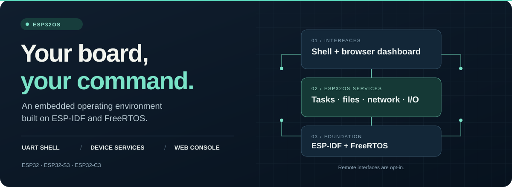
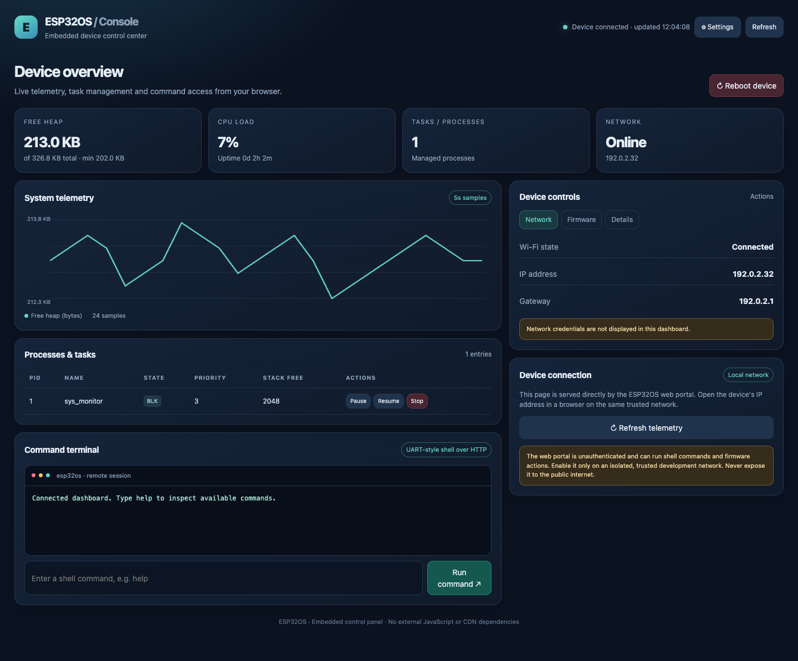
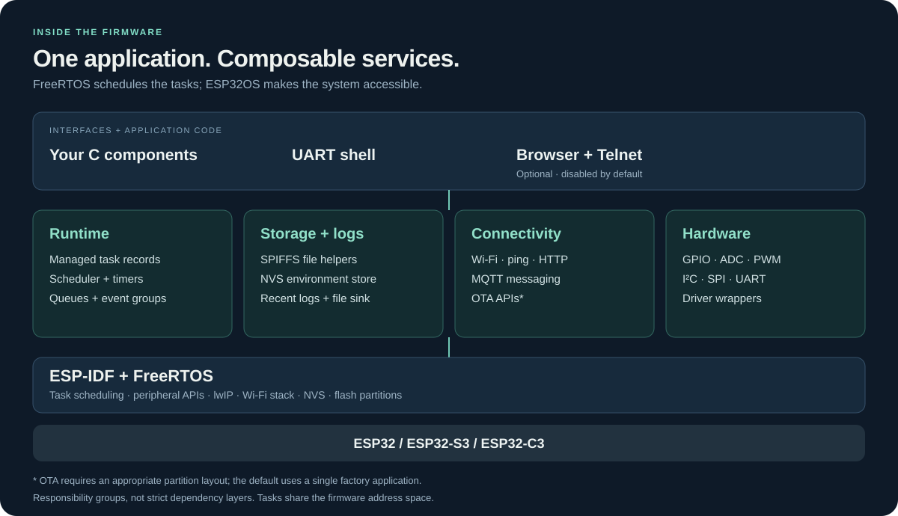

<div align="center">

# ESP32OS

**A small board. A familiar shell. A system you can inspect.**

An open-source embedded operating environment for ESP32, built on ESP-IDF and FreeRTOS.

[](https://github.com/faizannazir/Esp32OS/actions/workflows/pr-checks.yml)
[](https://docs.espressif.com/projects/esp-idf/en/v6.0/esp32/get-started/)
[](#hardware-and-build-support)
[](LICENSE)

[Get started](#get-started) · [Dashboard](#the-device-in-your-browser) · [Documentation](docs/README.md) · [Contribute](docs/CONTRIBUTING.md)



</div>

ESP32OS turns an ESP32 development board into an interactive embedded system. Flash one firmware image, open the UART console, and inspect tasks, work with files, connect to Wi-Fi, or control peripherals through a Linux-style command line. Add your own C components and managed FreeRTOS tasks as your project grows.

**FreeRTOS provides the real-time kernel. ESP32OS adds the shell, task-management APIs, services and device dashboard.** It is not a Linux distribution: there is no separate process address space, package manager or desktop application runtime.

## What you can do

| Capability | Available today |
|---|---|
| **Inspect the system** | Uptime, heap statistics, managed task list, task controls and recent logs |
| **Use the shell** | UART console, line editing, history, quoted arguments, variable expansion and extensible commands |
| **Work with flash storage** | SPIFFS file read/write/append/rename operations; NVS-backed environment variables |
| **Connect your device** | Wi-Fi station management, ICMP ping, HTTP GET and MQTT publish/subscribe |
| **Control hardware** | GPIO, ADC, I²C and PWM commands; SPI and additional UART APIs |
| **Run background work** | One-shot and repeating commands, software timers, message queues and event groups |
| **Open a device dashboard** | Optional browser view of metrics, telemetry, managed processes and device controls |

The default firmware starts with local UART access. The web portal, Telnet and open Wi-Fi AP are opt-in. See [network access](docs/USER_GUIDE.md#network-access) before enabling them.

## The device in your browser

The dashboard is a standalone HTML page embedded in the firmware and served by the board. It includes a free-heap chart, process controls, a command form, Wi-Fi status and appearance settings. No cloud account or frontend build step is required.



*Actual bundled dashboard rendered in a browser with sample API responses; not a live hardware capture or performance measurement. [Screenshot provenance](docs/assets/README.md).*

The page adapts to narrow screens and supports dark/light appearance, accent colors, panel visibility and refresh preferences. [View the mobile and settings captures →](docs/DASHBOARD.md#screenshots)

> The portal is disabled by default and has no authentication. Enable it only on an isolated development network. Its command form is request/response based; output capture is limited to handlers that use the shell output helpers. [Setup and limitations →](docs/DASHBOARD.md)

## Get started

You need a supported development board with **at least 4 MB flash**, a USB data cable, access to **UART0**, and the **ESP-IDF 6.0** toolchain. Use the Python environment supplied by ESP-IDF. Follow the [official installation guide](https://docs.espressif.com/projects/esp-idf/en/v6.0/esp32/get-started/) if the toolchain is not installed.

In an ESP-IDF terminal:

```bash
git clone https://github.com/faizannazir/Esp32OS.git
cd Esp32OS

# Linux/macOS: activate an existing ESP-IDF installation if needed.
. "$IDF_PATH/export.sh"

# Choose the chip on your board: esp32, esp32s3 or esp32c3.
idf.py set-target esp32
idf.py build

# Replace this port with your board's serial port.
idf.py -p /dev/ttyUSB0 flash monitor
```

On macOS, a USB-to-UART port may be `/dev/cu.usbserial-XXXX`; on Windows, use a port such as `COM3` in the ESP-IDF terminal. The console uses **115200 baud**. A board's native USB port may not expose the firmware's UART0 shell; check the board wiring.

At the `esp32os>` prompt, try these commands one at a time:

```text
help
uname -a
free
ps
write /hello.txt "Hello from ESP32OS"
cat /hello.txt
export DEVICE_NAME=bench
printenv DEVICE_NAME
```

These are commands to run, not fabricated device output. Results vary with your board and firmware configuration. Continue with the [User Guide](docs/USER_GUIDE.md) for networking, scheduling and troubleshooting.

## Hardware and build support

| Chip | ESP-IDF target | Repository CI |
|---|---|---|
| ESP32 | `esp32` | Firmware build and artifact checks |
| ESP32-S3 | `esp32s3` | Firmware build and artifact checks |
| ESP32-C3 | `esp32c3` | Firmware build and artifact checks |

The [PR workflow](.github/workflows/pr-checks.yml) uses `espressif/idf:v6.0`. Build coverage is not hardware certification: validate serial routing, flash capacity, pin assignments and peripherals on your exact board.

## How it fits together



The application entry point initializes components and starts the shell and monitor. Commands call component APIs; FreeRTOS schedules the underlying tasks. The diagram groups responsibilities, rather than promising a strict dependency hierarchy. See [Architecture](docs/ARCHITECTURE.md) for startup, memory and concurrency details.

## Current boundaries

- **Tasks share memory.** ESP32OS process IDs identify managed FreeRTOS tasks, not isolated operating-system processes. `ps` is not a complete list of ESP-IDF's internal tasks.
- **SPIFFS is a flat filesystem.** Directory commands exist, but marker files do not provide full POSIX directory behavior. Start with root-level file paths.
- **OTA needs a different flash layout.** The code includes OTA commands and APIs, but the shipped partition table has one factory application and no OTA slots or `otadata` partition. Updates and rollback need an appropriate layout and configuration.
- **Remote management is for development.** Telnet is plaintext and the HTTP portal is unauthenticated. Both are disabled by default.
- **Shell compatibility is limited.** Familiar command names do not imply Bash syntax, pipes, redirection, executable loading or Unix permissions.

## Develop and verify

Run the offline command-model checks without a board:

```bash
python3 tools/test_shell_host_integration.py
```

This checks a Python model of environment and scheduling commands, not the compiled C firmware. After an ESP-IDF build, check the generated artifacts:

```bash
python3 tools/test_build_health.py --target esp32
```

Serial integration tests and the built-in feature suites need hardware. See [Testing](docs/TESTING.md) for commands, side effects and coverage. [Actions](https://github.com/faizannazir/Esp32OS/actions) shows actual run results; [Releases](https://github.com/faizannazir/Esp32OS/releases) contains published artifacts.

## Documentation

| Start here | Go deeper |
|---|---|
| [User Guide](docs/USER_GUIDE.md) — build, flash and first commands | [Architecture](docs/ARCHITECTURE.md) — runtime design and boundaries |
| [Browser Dashboard](docs/DASHBOARD.md) — setup, controls and screenshots | [Components](docs/COMPONENTS.md) — APIs and source map |
| [Testing](docs/TESTING.md) — host and hardware validation | [Extending](docs/EXTENDING.md) — commands, tasks and drivers |
| [Contributing](docs/CONTRIBUTING.md) — development workflow | [Documentation index](docs/README.md) — all guides |

Contributions are welcome: reproducible fixes, board validation, drivers, useful examples and clearer documentation. Read the [contribution guide](docs/CONTRIBUTING.md) and include what you tested.

ESP32OS is released under the [MIT License](LICENSE). See the [Branding Policy](BRANDING_POLICY.md) and [Notice](NOTICE.md) for attribution. This is an independent project, not an official Espressif or FreeRTOS distribution.
