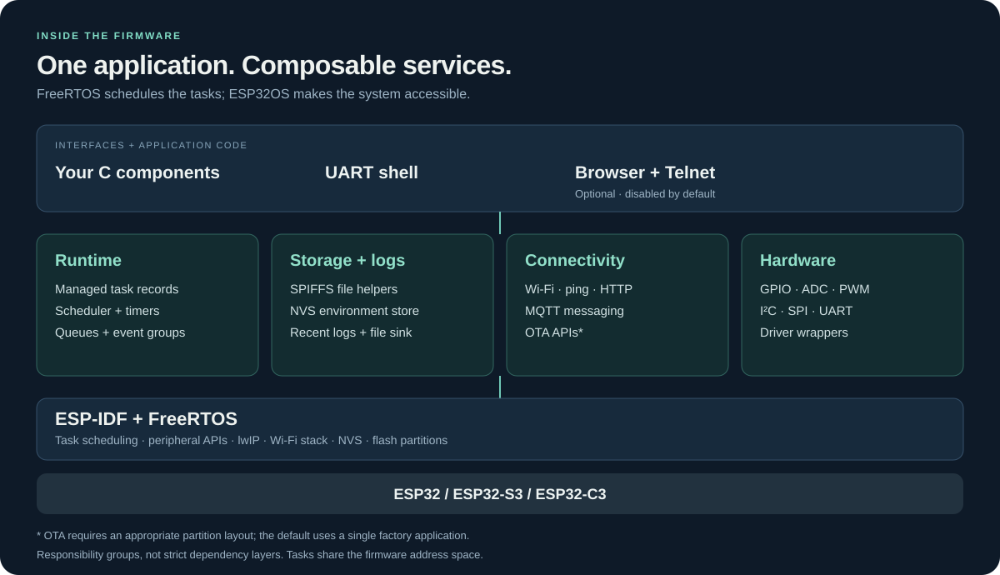

# ESP32OS architecture

[Documentation](README.md) · [Components](COMPONENTS.md) · [Extending](EXTENDING.md)

ESP32OS is an embedded operating environment within a single ESP-IDF application. FreeRTOS owns task scheduling; ESP32OS supplies managed task records, command dispatch, storage helpers, network services and device interfaces. Application tasks share the firmware's address space.

This is a responsibility map, not a strict dependency graph. Components have cross-dependencies: the scheduler invokes shell commands, the shell calls services, and the portal uses shell capture and service APIs. Inspect each component's `CMakeLists.txt` before changing dependencies.

## Startup

[`app_main()`](../main/main.c) performs this sequence:

1. Initialize NVS, logging, boot information and reset-reason reporting.
2. Mount SPIFFS; enable file logging if the mount succeeds.
3. Initialize the managed process table. Kernel initialization failure restarts the device.
4. Initialize the HAL, PWM, timers, environment store, command scheduler and IPC.
5. Initialize networking. When that succeeds, initialize MQTT and OTA, then start the portal if enabled.
6. Enable the task watchdog, initialize the shell and register built-in commands.
7. Start the UART shell and, if configured, the Telnet server on port 2222.
8. Create the `sys_monitor` task. The main task then feeds its watchdog in a one-second loop.

Many service failures are logged and startup continues. A boot-complete message alone does not prove every component initialized successfully. The monitor logs heap/process statistics every 30 seconds; it is not the task that feeds the main loop's watchdog.

## Managed tasks

[`os_kernel`](../components/os_kernel/include/os_kernel.h) maps FreeRTOS task handles to a static table of up to `OS_MAX_PROCESSES` (20) descriptors. Each record has a PID, name, state, priority and stack/runtime fields. Task stacks and FreeRTOS resources still require memory allocation; a static descriptor table does not make the runtime allocation-free.

- `os_process_create()` returns a PID, or zero on failure.
- `os_process_get()` and `os_process_find_by_name()` copy a snapshot into a caller-provided `process_t`.
- `ps` and the dashboard show managed records, not every internal Wi-Fi, lwIP or ESP-IDF task.
- Suspend, resume and kill act on tasks. They do not provide memory isolation, Unix signals or automatic cleanup of application-owned resources.
- CPU load is approximate; displayed telemetry is not a benchmark or a real-time scheduling guarantee.

A mutex protects the process table. That protection does not extend to all shared state in other components; review each API's implementation for concurrency assumptions.

## Shell and remote interfaces

[`os_shell`](../components/os_shell/src/os_shell.c) provides command registration, argument parsing, variable expansion, a UART line editor and optional Telnet sessions. Session histories are allocated separately, but services and configuration are shared. Filesystem CWD is module state, not a per-session working directory.

The shell supports double-quoted arguments and command-specific help. It does not implement a general POSIX shell, pipelines, redirection or a program loader. Scheduled jobs dispatch registered commands through the same shell.

The optional HTTP portal embeds [`dashboard/index.html`](../components/webportal/dashboard/index.html) and calls service APIs. `/api/command` uses `shell_execute_capture()`: output through `shell_write()` and `shell_printf()` can be captured, while components that write directly to UART or sockets can bypass capture. See [Dashboard](DASHBOARD.md) for the API and operational limits.

## Storage

[`os_fs`](../components/os_fs/src/os_fs.c) mounts SPIFFS at `/spiffs`, with a maximum of 10 open files. Logical `/hello.txt` resolves to `/spiffs/hello.txt`. The filesystem wrapper keeps a global CWD string and resolves relative paths against it.

SPIFFS is flat. `os_fs_mkdir()` attempts a `.dir` marker fallback when native directories are unsupported, but `chdir()` still requires a directory reported by `stat()`, and listing delegates to the underlying VFS. Do not treat `/logs`, `/tmp` and `/etc` as fully implemented POSIX directories. Root-level file examples avoid that dependency.

The mount uses `format_if_mount_failed = true`; a failed mount can trigger formatting. Back up files you need before storage experiments or partition changes.

The [environment store](../components/os_env/src/os_env.c) keeps variables in memory and persists a blob in the `esp32os_env` NVS namespace. These variables are shared across shell sessions. Setting `WIFI_SSID` as a shell variable does not itself configure the Wi-Fi driver.

## Logging

[`os_logging`](../components/os_logging/include/os_logging.h) provides level filtering, UART output, a 64-entry recent-message ring and optional file output to `/spiffs/system.log`. `dmesg` reads the ring; `loglevel` changes filtering; `logfile` toggles the file sink. Ring contents are lost on reboot.

## Networking and peripherals

[`os_networking`](../components/os_networking/src/os_networking.c) initializes the ESP-IDF network stack and Wi-Fi station, uses event groups for connection state, and attempts to load credentials from the `wifi_cfg` NVS namespace. The public `os_wifi_save_credentials()` API stores those credentials; the shell's `wifi connect` handler does not call it. Disconnect handling includes up to five reconnect attempts.

GPIO, ADC, I²C, SPI and extra UART wrappers live in [`os_drivers`](../components/os_drivers/include/os_drivers.h). `os_hal` is an umbrella interface. ADC uses ESP-IDF's oneshot API and calibration support where configured; pin maps and calibration behavior vary by target. PWM is a separate component built on LEDC. Validate all peripheral pin choices against your board.

## Default flash layout

The custom [`partitions.csv`](../partitions.csv) fits a 4 MiB flash device:

| Partition | Offset | Size | Purpose |
|---|---|---|---|
| `nvs` | `0x9000` | `0x6000` — 24 KiB | Persistent key/value storage |
| `phy_init` | `0xF000` | `0x1000` — 4 KiB | PHY data |
| `factory` | `0x10000` | `0x200000` — 2 MiB | Firmware application |
| `spiffs` | `0x210000` | `0x1E0000` — 1920 KiB | File storage |
| `coredump` | `0x3F0000` | `0x10000` — 64 KiB | Crash dump storage |

The partition table is configured at `0x8000`. Bootloader placement is target-specific; use the generated flasher arguments rather than assuming a universal bootloader offset.

**There is no OTA destination in this layout.** The OTA component and shell/API controls exist, but updating and rollback require an OTA-capable partition table and matching bootloader configuration. Changing the layout can move or overwrite stored data. See the [OTA prerequisites](USER_GUIDE.md#ota-prerequisites).

## Access defaults

[`Kconfig.projbuild`](../Kconfig.projbuild) disables the web portal, Telnet and AP fallback by default. If enabled, the AP is open, Telnet is plaintext with locally configured credentials, and the HTTP portal has no authentication. These are development interfaces, not security boundaries for untrusted clients.
