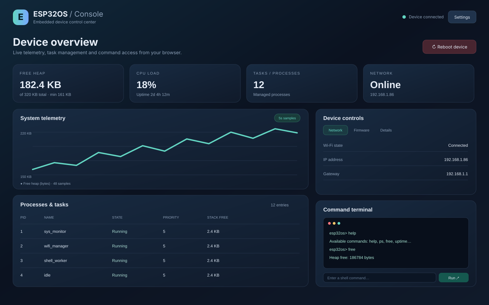
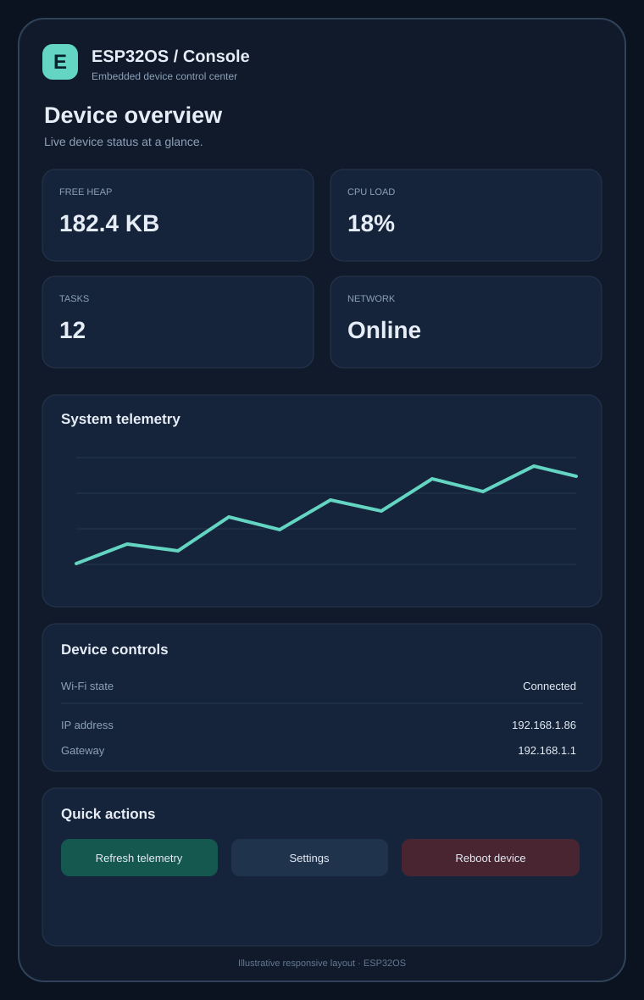

# ESP32OS Browser Dashboard

ESP32OS includes an optional browser-based device dashboard served directly by the ESP32. It complements the UART shell; it does not replace it or require a cloud service.

## What it provides

- Live heap, CPU-load, uptime and process-count metrics.
- A rolling free-heap telemetry chart.
- A process table with suspend, resume and terminate actions.
- A browser terminal that executes existing ESP32OS shell commands.
- Wi-Fi station connection, IP address and gateway status.
- OTA confirmation and rollback controls.
- Device reboot control.

## Enable the dashboard

The web portal is disabled by default. It currently has no authentication and exposes powerful device-control endpoints. Enable it only on a trusted, isolated development network.

1. Connect to the board over UART.
2. Run `idf.py menuconfig` in the project directory.
3. Open **ESP32OS Security and Network Services**.
4. Enable the web portal option.
5. Save the configuration, rebuild and flash the firmware.
6. Connect the board to a trusted Wi-Fi network using the UART shell.
7. Open the board's station IP address in a browser on the same network.

```bash
idf.py menuconfig
idf.py build
idf.py -p /dev/ttyUSB0 flash monitor
```

## Dashboard previews

These repository-hosted SVG previews illustrate the desktop and narrow-screen layouts. They are design previews, not photographs or captures from a physical ESP32 board.





## Personalize your dashboard

Select **Settings** in the dashboard header to customize the browser view:

- **Dashboard title:** set a heading that identifies your board or project.
- **Appearance:** choose dark, light or follow the operating system preference.
- **Accent color:** choose mint, blue, violet or amber.
- **Layout density:** use comfortable spacing or a compact layout.
- **Auto-refresh:** choose 3, 5, 10 or 30 seconds, or disable automatic refresh for manual-only updates.
- **Panel visibility:** show or hide metric cards, telemetry chart, process table, command terminal and device controls.

Select **Save preferences** to apply and save choices in this browser using local storage. **Reset defaults** restores the original dashboard layout. Preferences are browser-specific: they are not sent to the ESP32, do not modify firmware settings and are not shared with other users or browsers. Clearing this browser's site data resets them.

## Security warning

The dashboard is a management interface, not a hardened remote administration service. It currently has no login, session authentication, TLS, CSRF protection or role-based authorization. Its endpoints can execute shell commands, manage tasks, confirm or roll back firmware, and reboot the device.

- Do not expose the portal to the public internet.
- Do not enable it on shared, guest or otherwise untrusted Wi-Fi.
- Prefer UART access for production devices.
- Keep the portal disabled in production firmware unless a secured access layer has been added and reviewed.

## Current API surface

| Method | Endpoint | Purpose |
|---|---|---|
| GET | `/` | Embedded dashboard page |
| GET | `/api/status` | Heap, CPU, uptime and network status |
| GET | `/api/processes` | Managed process list |
| GET | `/api/telemetry/history` | Recent system samples |
| GET | `/api/process/history?pid=...` | History for one process |
| GET | `/api/ota` | OTA confirmation and rollback state |
| POST | `/api/process/action` | Suspend, resume or terminate a process |
| POST | `/api/command` | Execute an ESP32OS shell command |
| POST | `/api/ota/confirm` | Confirm the running OTA image |
| POST | `/api/ota/rollback` | Roll back to the previous image |
| POST | `/api/system/reboot` | Restart the device |

## Implementation notes

- The dashboard is a standalone HTML asset embedded into the firmware by ESP-IDF CMake; it does not download JavaScript libraries or depend on a hosted frontend.
- The page uses the existing web portal API, so UART shell commands remain available independently.
- Dashboard telemetry is sampled by the existing portal sampler. Data is held in a bounded in-memory ring buffer and is lost on reboot.
- Network information is currently read-only in the dashboard. Use the UART shell for Wi-Fi configuration.

## Future hardening

Before enabling this interface in production, add authenticated sessions, TLS or a trusted reverse-proxy boundary, CSRF protection, per-endpoint authorization, rate limiting and audit logging. OTA confirmation, rollback, reboot and process termination should require explicit authorization.
