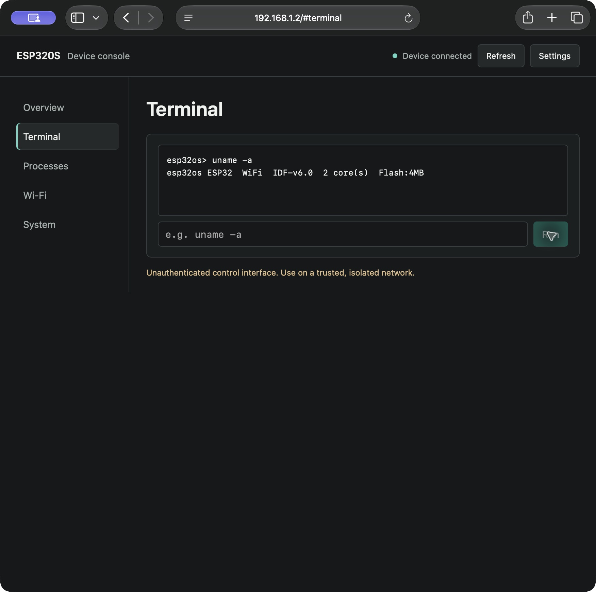

# Browser dashboard

[Documentation](README.md) · [User Guide](USER_GUIDE.md) · [API](#http-api)

The optional ESP32OS dashboard is served directly by the device. Its HTML, CSS and JavaScript are bundled into the firmware; there are no external frontend libraries or cloud services to configure.

## Enable and connect

The portal is **disabled by default** and has no authentication. Use only on an isolated, trusted development network.

1. In the project directory, run `idf.py menuconfig`.
2. Open **ESP32OS Security and Network Services** and enable the web control portal (`CONFIG_ESP32OS_ENABLE_WEB_PORTAL`).
3. Save, rebuild and flash.
4. Use UART to join Wi-Fi, then read the station IP with `wifi status`.
5. Open `http://<board-ip>/` from a browser on the same network.

```bash
idf.py build
idf.py -p /dev/ttyUSB0 flash monitor
```

At the device prompt, substitute your local credentials:

```text
wifi connect "Your SSID" "Your password"
wifi status
```

The web portal and Telnet are separate options; you do not need to enable Telnet or the open AP to use the dashboard.

## Device apps

| Screen | What you can do |
|---|---|
| Overview | Check heap, approximate CPU load, uptime, task count and Wi-Fi station state |
| Terminal | Send shell commands and view their captured output |
| Processes | Inspect, pause, resume or stop managed FreeRTOS tasks |
| Wi-Fi | Scan nearby networks, choose one and connect the station |
| System | Check memory and uptime, inspect OTA state or reboot the device |

Process controls affect real tasks. Use UART as a recovery interface when experimenting. OTA confirmation and rollback depend on the board's current firmware state and partition layout. See [OTA prerequisites](USER_GUIDE.md#ota-prerequisites).

## Join a Wi-Fi network from the console

1. Open **Wi-Fi** from the sidebar and select **Scan**.
2. Choose a named network. The list shows signal strength and whether it requires a password.
3. For a secured network, enter its password. Select **Connect**.
4. Check the **Network** name and station IP shown after connection. If changing networks disconnects the browser, run `wifi status` over UART and reopen the console at the new IP.

This joins open or compatible WPA personal networks in range of your board. The browser does not save the password in its preferences. The unauthenticated portal sends credentials over HTTP. Use an isolated setup network or use UART if you need to avoid sending credentials over HTTP.

## Live screenshots

The console below was served by a physical ESP32-D0WD-V3 with 4 MB flash and opened in Safari over shared Wi-Fi.

| Overview | Browser terminal | Widget settings |
|---|---|---|
| [Live metrics and heap history](assets/dashboard-live-desktop.jpg) | [Real response to `uname -a`](assets/dashboard-live-terminal.jpg) | [Widget controls](assets/dashboard-live-settings.jpg) |



Use the [USB terminal instructions](USER_GUIDE.md#connect-over-usb-and-open-the-terminal) for direct serial access.

## Command capture limits

The command panel is a request/response form, not a streaming UART emulator. The server runs `shell_execute_capture()` with a bounded output buffer. Handlers that use `shell_write()` or `shell_printf()` participate in capture; some component printers write directly to UART or sockets and can bypass it. Long output can be truncated, and commands waiting for interactive input are unsuitable here.

Use a simple command such as `echo hello` to check the round trip. If a command reports no text, try the UART shell before assuming it failed. Use UART for boot logs and interactive debugging.

## Personalize the view

Select **Settings** to change the dashboard title, dark/light/system appearance, mint/blue/violet/amber accent, comfortable/compact spacing, automatic refresh (3, 5, 10 or 30 seconds, or manual), and overview widgets. Tick **Device metrics**, **Free heap history**, or **App shortcuts** to show them. Use **Up** and **Down** to reorder them.

**Save preferences** stores choices in this browser's local storage. **Reset defaults** fills the default choices; save to persist them. Preferences do not change firmware, Wi-Fi configuration or another browser's view. Clearing site data resets saved preferences.

The default refresh interval is five seconds. Device telemetry is independently sampled every five seconds into a 24-entry RAM ring. Changing browser refresh does not change sampling frequency; history is lost on reboot.

## HTTP API

The implementation lives in [`webportal.c`](../components/webportal/src/webportal.c).

| Method | Endpoint | Purpose / request body |
|---|---|---|
| GET | `/` | Embedded HTML dashboard |
| GET | `/api/status` | Heap, approximate CPU, uptime and station status including the associated SSID as `ssid_hex` |
| GET | `/api/processes` | Managed process list |
| GET | `/api/telemetry/history` | Recent system samples |
| GET | `/api/process/history?pid=...` | Recent samples for a managed process |
| GET | `/api/ota` | Confirmation and rollback availability |
| GET | `/api/wifi/scan` | Nearby named networks with hex-encoded SSIDs, RSSI and open status |
| POST | `/api/wifi/connect` | Binary body containing one SSID-length byte, the SSID bytes and the password bytes |
| POST | `/api/process/action` | Body `pid=<id>&action=<suspend\|resume\|kill>` |
| POST | `/api/command` | Plain-text shell command |
| POST | `/api/ota/confirm` | Confirm the running image when supported |
| POST | `/api/ota/rollback` | Request rollback when supported |
| POST | `/api/system/reboot` | Restart the device |

The Wi-Fi join request uses `application/octet-stream`. Shell commands and device actions use `text/plain`, including the process-action body. Status/history endpoints return JSON; command and action endpoints return text. The process-history API exists even though the current page charts system free heap only.

## Security boundary

The current portal has no login, authenticated session, TLS, CSRF protection or role-based authorization. Anyone who can reach it may be able to execute shell commands and control the device. Do not expose it to the internet, guest Wi-Fi or other untrusted clients. Keep it disabled for deployments until an appropriate secured access layer has been implemented and reviewed.

## Troubleshooting

If the dashboard says the device is unavailable, check power, Wi-Fi status, the current station IP and the portal-enabled firmware configuration. If a reboot changes the DHCP address, reopen the page at the new IP. If a panel is missing, inspect Settings. If a command has no output, see [capture limits](#command-capture-limits).
