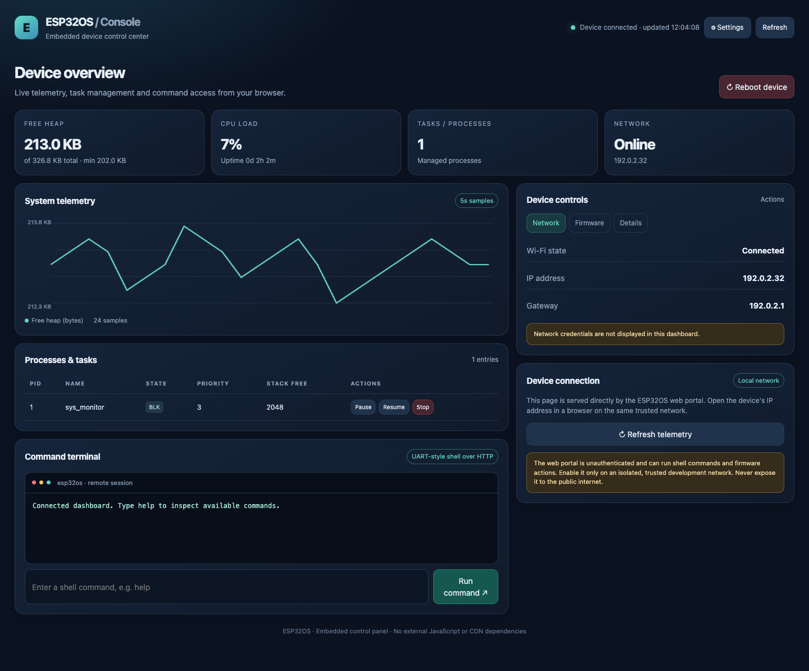
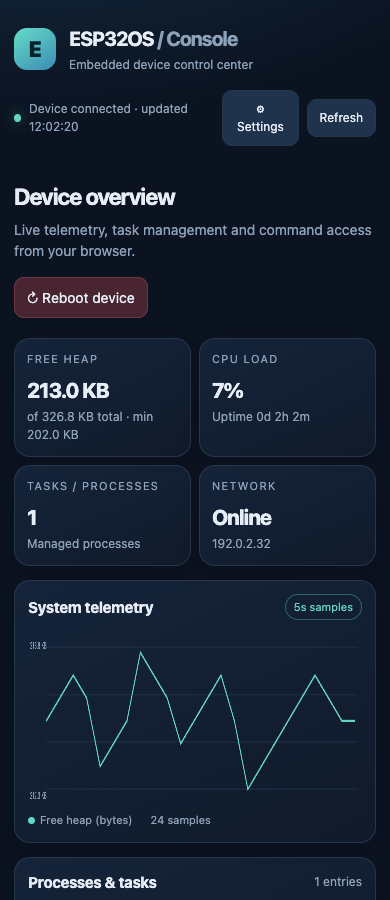
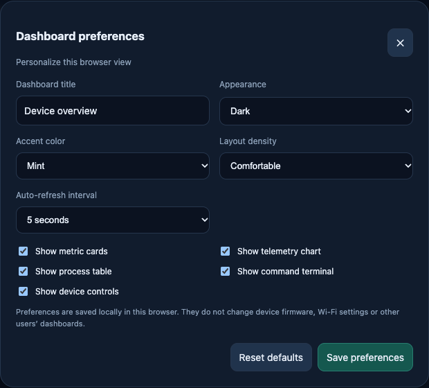

# Browser dashboard

[Documentation](README.md) · [User Guide](USER_GUIDE.md) · [API](#http-api)

The optional ESP32OS dashboard is served directly by the device. Its HTML, CSS and JavaScript are bundled into the firmware; there are no external frontend libraries or cloud services to configure.

## Enable and connect

The portal is **disabled by default** and has no authentication. Use only on an isolated, trusted development network.

1. In the project directory, run `idf.py menuconfig`.
2. Open **ESP32OS Security and Network Services** and enable the web control portal (`CONFIG_ESP32OS_ENABLE_WEB_PORTAL`).
3. Save, rebuild and flash.
4. Use UART to join Wi-Fi, then read the station IP with `wifi status`.
5. Open `http://<board-ip>/` from a browser on the same network.

```bash
idf.py build
idf.py -p /dev/ttyUSB0 flash monitor
```

At the device prompt, substitute your local credentials:

```text
wifi connect "Your SSID" "Your password"
wifi status
```

The web portal and Telnet are separate options; you do not need to enable Telnet or the open AP to use the dashboard.

## Screenshots

These are browser captures of the actual [bundled dashboard](../components/webportal/dashboard/index.html), populated with **sample API responses**. They are not captures from a physical ESP32. Values, task rows and addresses illustrate the interface, not measured performance. See [asset provenance](assets/README.md).

### Desktop



### Mobile

<p align="center"></p>

### Preferences



## Use the panels

| Panel | Behavior |
|---|---|
| Metrics | Free heap, approximate CPU load, uptime, managed process count and network status |
| Telemetry | A rolling chart of free heap from the device's recent samples |
| Processes | Managed task snapshots with Pause, Resume and Stop actions |
| Command terminal | Submits a command string and displays its captured response |
| Device controls | Read-only Wi-Fi status, memory details, OTA state and reboot/OTA actions |

Process controls affect real device tasks. The process table does not represent every ESP-IDF internal task. Use UART as a recovery interface when experimenting with task control.

OTA buttons reflect reported state. The default partition table contains no OTA slots; see [OTA prerequisites](USER_GUIDE.md#ota-prerequisites) before expecting update confirmation or rollback to be available.

## Command capture limits

The command panel is a request/response form, not a streaming UART emulator. The server runs `shell_execute_capture()` with a bounded output buffer. Handlers that use `shell_write()` or `shell_printf()` participate in capture; some component printers write directly to UART or sockets and can bypass it. Long output can be truncated, and commands waiting for interactive input are unsuitable here.

Use a simple command such as `echo hello` to check the round trip. If a command reports no text, try the UART shell before assuming it failed. Use UART for boot logs and interactive debugging.

## Personalize the view

Select **Settings** to change the dashboard title, dark/light/system appearance, mint/blue/violet/amber accent, comfortable/compact spacing, automatic refresh (3, 5, 10 or 30 seconds, or manual), and visible panels.

**Save preferences** stores choices in this browser's local storage. **Reset defaults** fills the default choices; save to persist them. Preferences do not change firmware, Wi-Fi configuration or another browser's view. Clearing site data resets saved preferences.

The default refresh interval is five seconds. Device telemetry is independently sampled every five seconds into a 24-entry RAM ring. Changing browser refresh does not change sampling frequency; history is lost on reboot.

## HTTP API

The implementation lives in [`webportal.c`](../components/webportal/src/webportal.c).

| Method | Endpoint | Purpose / request body |
|---|---|---|
| GET | `/` | Embedded HTML dashboard |
| GET | `/api/status` | Heap, approximate CPU, uptime and network status |
| GET | `/api/processes` | Managed process list |
| GET | `/api/telemetry/history` | Recent system samples |
| GET | `/api/process/history?pid=...` | Recent samples for a managed process |
| GET | `/api/ota` | Confirmation and rollback availability |
| POST | `/api/process/action` | Body `pid=<id>&action=<suspend\|resume\|kill>` |
| POST | `/api/command` | Plain-text shell command |
| POST | `/api/ota/confirm` | Confirm the running image when supported |
| POST | `/api/ota/rollback` | Request rollback when supported |
| POST | `/api/system/reboot` | Restart the device |

The dashboard sends POST bodies with `Content-Type: text/plain`, including the form-like process-action body. Status/history endpoints return JSON; command and action endpoints return text. The process-history API exists even though the current page charts system free heap only. There is no Wi-Fi configuration form; use UART commands.

## Security boundary

The current portal has no login, authenticated session, TLS, CSRF protection or role-based authorization. Anyone who can reach it may be able to execute shell commands and control the device. Do not expose it to the internet, guest Wi-Fi or other untrusted clients. Keep it disabled for deployments until an appropriate secured access layer has been implemented and reviewed.

## Troubleshooting

If the dashboard says the device is unavailable, check power, Wi-Fi status, the current station IP and the portal-enabled firmware configuration. If a reboot changes the DHCP address, reopen the page at the new IP. If a panel is missing, inspect Settings. If a command has no output, see [capture limits](#command-capture-limits).
