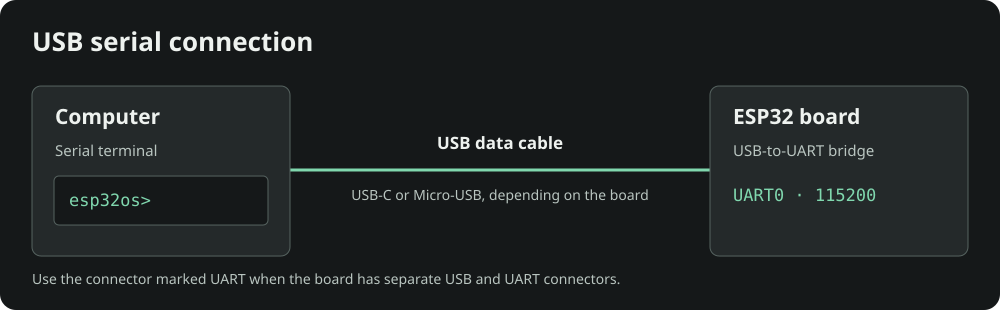

# ESP32OS user guide

[Documentation](README.md) · [Dashboard](DASHBOARD.md) · [Testing](TESTING.md)

Build and flash the firmware, start with the UART console, then enable the services you need.

## Prepare your board

- Use an ESP32, ESP32-S3 or ESP32-C3 development board with at least 4 MB flash for the shipped partition layout.
- Install [ESP-IDF 6.0](https://docs.espressif.com/projects/esp-idf/en/v6.0/esp32/get-started/) and use its configured Python environment.
- Connect a USB data cable and identify the board's serial port. The firmware shell reads **UART0 at 115200 baud**. Native USB and a USB-to-UART bridge are not interchangeable on every board.
- Check your board's schematic before connecting peripherals. Chip family support does not establish safe pin assignments for every board.

## Connect over USB and open the terminal



1. Connect the board to your computer with a **USB data cable**. Use the board's USB-to-UART connector if it has separate native USB and UART ports.
2. Find the serial port. Compare the port list before and after plugging in the board.

   | System | How to find the port |
   |---|---|
   | macOS | Run `ls /dev/cu.*`. The test board appeared as `/dev/cu.usbserial-0001`. |
   | Linux | Run `ls /dev/ttyUSB* /dev/ttyACM*` and identify the new port. |
   | Windows | Open **Device Manager → Ports (COM & LPT)** and note the new COM port. |

3. For a board that already has ESP32OS installed, open the monitor from the project directory in an ESP-IDF terminal. Substitute your own port.

   ```bash
   idf.py -p /dev/cu.usbserial-0001 monitor
   ```

   On macOS you can also open the shell without the ESP-IDF monitor:

   ```bash
   screen /dev/cu.usbserial-0001 115200
   ```

4. Press **Enter** and look for `esp32os>`. Type `help` or `uname -a`. The test board returned this over UART:

   ```text
   esp32os> uname -a
   esp32os ESP32  WiFi  IDF-v6.0  2 core(s)  Flash:4MB
   ```

5. Exit the ESP-IDF monitor with **Ctrl+]**. In `screen`, press **Ctrl+A**, then **K**, and confirm. Close the serial session before flashing or running the integration script.

If you only see an LED and no serial port, try a known data cable and the UART connector. If the port opens but the prompt is missing, check 115200 baud, press **Enter**, and reset the board if needed.

## Build and flash

Run from the repository root in an ESP-IDF terminal. On Linux/macOS, activate an existing installation if needed:

```bash
. "$IDF_PATH/export.sh"
idf.py --version
idf.py set-target esp32
idf.py build
idf.py -p /dev/ttyUSB0 flash monitor
```

Replace `esp32` with `esp32s3` or `esp32c3` to match the chip. Replace the port with your device: for example, `/dev/cu.usbserial-XXXX` on macOS or `COM3` on Windows. On Windows, use the ESP-IDF terminal instead of the Unix `export.sh` command.

`set-target` regenerates build configuration. Keep any local configuration changes you need before switching targets. Exit the IDF serial monitor with **Ctrl+]**.

## First commands

Boot logs show initialization results. When you reach `esp32os>`, enter the following commands individually:

```text
help
uname -a
uptime
free
ps
df
dmesg 10
```

`ps` shows ESP32OS-managed tasks. `top` prints a snapshot rather than a continuously updating Unix `top` interface. Memory values, process IDs and log lines depend on the build and board.

Use `help` for the command list, `wifi --help` for the registered usage, or `wifi` without arguments for its subcommand help. The shell accepts double-quoted strings. It does not provide Bash scripting, pipes or redirection.

## Files and variables

Use root-level filenames with the default SPIFFS filesystem:

```text
write /hello.txt "Hello from ESP32OS"
cat /hello.txt
append /hello.txt "Another message"
cat /hello.txt
mv /hello.txt /notes.txt
ls /
rm /notes.txt
```

SPIFFS has no native directories. Although `mkdir`, `cd` and path-prefix helpers exist, they do not establish a complete directory tree. See [storage behavior](ARCHITECTURE.md#storage). A failed filesystem mount can trigger formatting under the current configuration.

Environment values are shared and persisted in NVS:

```text
export DEVICE_NAME=bench
printenv DEVICE_NAME
echo $DEVICE_NAME
env
unset DEVICE_NAME
```

Environment variables do not automatically configure services. For example, exporting `WIFI_SSID` does not connect the device to Wi-Fi.

## Connect to Wi-Fi

Enter your local credentials at the UART prompt:

```text
wifi scan
wifi connect "Your SSID" "Your password"
wifi status
ifconfig
```

Use the IP returned by `wifi status` for the dashboard or Telnet. For diagnostics, replace the following address with your gateway:

```text
ping 192.168.1.1 -c 3
```

The `wifi connect` handler connects the current session; it does not call the explicit `os_wifi_save_credentials()` persistence API. Firmware developers can use that API for boot-time reconnect from NVS. Keep credentials out of commits, screenshots and shared serial logs.

## Background commands and timers

```text
run echo background
at 5000 echo delayed
every 10000 uptime
jobs
```

`run` starts a background command, `at` uses a delay in milliseconds, and `every` repeats at a millisecond interval. Use the generated job name shown by `jobs` to stop a repeating job:

```text
killjob <job-name>
```

Software timers are separate from scheduled shell commands:

```text
timer create heartbeat 1000 1
timer start heartbeat
timer list
timer stop heartbeat
timer delete heartbeat
```

The shell timer callback records timer activity; a custom C callback is needed for application-specific work. Jobs and timers use RAM and do not survive reboot.

## IPC and MQTT

Create a named queue with 16-byte messages and capacity for four messages:

```text
msgq create demo 16 4
msgq send demo hello
msgq recv demo 1000
msgq delete demo
```

For MQTT, connect Wi-Fi first. Substitute the address of a broker you control:

```text
mqtt config mqtt://192.168.1.20:1883
mqtt connect
mqtt status
mqtt sub lab/esp32/status -q 0
mqtt pub lab/esp32/status online -q 0
mqtt pubhex lab/esp32/raw DEADBEEF -q 0
mqtt disconnect
```

Connection is asynchronous: confirm `mqtt status` reports a connection before publishing. `pub` takes a text argument; `pubhex` sends binary bytes encoded as hexadecimal. The example broker connection is plaintext.

## Hardware commands

| Command | Purpose |
|---|---|
| `gpio info` | Inspect GPIO information |
| `gpio mode <pin> out` | Configure an output |
| `gpio write <pin> <0\|1>` | Set an output level |
| `gpio read <pin>` | Read a digital input |
| `adc read <channel>` | Read a raw ADC value |
| `adc readv <channel>` | Read a voltage value using the driver's conversion |
| `i2c scan <sda> <scl>` | Initialize/probe an I²C bus on selected pins |
| `pwm init <channel> <gpio> <frequency_hz>` | Configure a PWM output |
| `pwm duty <channel> <percent>` | Set PWM duty cycle |
| `pwm deinit <channel>` | Release a PWM channel |

The angle-bracket fields are placeholders. Choose pins from your board's schematic and the driver implementation; flash, boot-strapping, USB and input-only pins have target-specific constraints. These examples do not validate any connected sensor or actuator.

## Network access

All three options below are **disabled by default**. Change them locally under **ESP32OS Security and Network Services**:

```bash
idf.py menuconfig
idf.py build
idf.py -p /dev/ttyUSB0 flash monitor
```

| Option | What enabling it does |
|---|---|
| `CONFIG_ESP32OS_ENABLE_WEB_PORTAL` | Starts the unauthenticated HTTP dashboard and control API; see [Dashboard](DASHBOARD.md) |
| `CONFIG_ESP32OS_ENABLE_TELNET` | Enables the plaintext shell on port 2222; requires non-empty local username/password settings |
| `CONFIG_ESP32OS_ENABLE_AP_FALLBACK` | Enables the device-hosted open access point named `ESP32OS` |

Only enable remote interfaces on an isolated, trusted development network. Do not expose the portal to the internet. There are no default Telnet credentials; set your own in `menuconfig`, keep `sdkconfig` local, then connect with `telnet <board-ip> 2222`.

## OTA prerequisites

The `ota` command exists, but the default [partition table](../partitions.csv) has only a `factory` application. It has no `ota_0`, `ota_1` or `otadata` partitions, so it is not ready for an OTA update/rollback workflow.

Before using `ota update`, provide a flash layout that fits the device and includes OTA metadata and application slots, configure the bootloader features required by your rollback policy, and validate the complete update path on hardware. Partition changes may overwrite existing data. Continue using serial flashing with the default layout.

You can inspect the current state without starting an update:

```text
ota status
```

`ota confirm` and `ota rollback` apply only when the running image and partition state support those operations. Their presence in the dashboard is not evidence that the default firmware can roll back.

## Troubleshooting

| Symptom | Check |
|---|---|
| `idf.py` is missing | Open the ESP-IDF terminal or activate the installed toolchain |
| Target/build mismatch | Confirm `idf.py set-target` matches the chip; review regenerated configuration |
| Serial port cannot open | Confirm the port, USB driver and data cable; close other serial monitors |
| Logs appear but no shell input | Confirm UART0 routing and 115200 baud; native USB logs may use another interface |
| Dashboard does not load | Enable the portal, rebuild/flash, connect Wi-Fi and open `http://<station-ip>/` on the same network |
| Browser command produces no text | Some component output bypasses shell capture; retry via UART |
| `cd` or directory listing fails | Use root-level SPIFFS files; see [storage limits](ARCHITECTURE.md#storage) |
| OTA has no update destination | The default layout has no OTA slots |

Use [Testing](TESTING.md) to gather reproducible results. Hardware test scripts change files, NVS values and GPIO state; review their operations before running them on a connected project.
